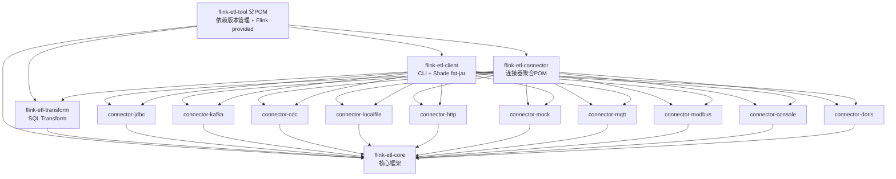

# Flink ETL Tool — Code Wiki

> 基于 Apache Flink 1.15.2 的**配置驱动 ETL 工具**，定位类似 DataX / SeaTunnel：通过一份 JSON
> 配置文件即可定义并运行数据同步任务，无需编码。支持批处理（batch）与流处理（streaming）两种模式，插件化架构，易于扩展。

---

## 目录

- [1. 项目概述](#1-项目概述)
- [2. 技术栈](#2-技术栈)
- [3. 项目整体架构](#3-项目整体架构)
- [4. 模块结构与职责](#4-模块结构与职责)
- [5. 关键类与函数详解](#5-关键类与函数详解)
- [6. 依赖关系](#6-依赖关系)
- [7. 项目运行方式](#7-项目运行方式)
- [8. 扩展开发指南](#8-扩展开发指南)
- [9. 附录](#9-附录)

---

## 1. 项目概述

### 1.1 项目定位

| 维度   | 说明                                                          |
|------|-------------------------------------------------------------|
| 项目名称 | Flink ETL Tool（`com.etl:flink-etl-tool`，版本 1.0.0-SNAPSHOT）  |
| 核心能力 | 配置驱动的批流一体数据同步：Source → Transform（SQL）→ Sink                 |
| 设计参考 | DataX（JSON 配置风格）、SeaTunnel（插件化架构）                           |
| 运行形态 | 单机 Local 模式运行（fat-jar 内嵌 Flink mini cluster），也可提交到 Flink 集群 |
| 扩展方式 | Java SPI（`ServiceLoader` + Google `@AutoService` 注解）        |

### 1.2 核心特性

- **配置驱动**：JSON 定义任务，支持 `${variable}` / `${variable:-default}` 变量替换
- **批流一体**：同一套配置与插件体系，`mode: batch | streaming` 切换
- **插件化**：Source / Sink / Transform / UDF 四类插件均基于 SPI 动态加载
- **并行读取**：JDBC 分片并行（数值/日期/字符串 Hash/全表扫描 4 种策略）、文件级并行
- **CDC 支持**：MySQL CDC Source + JDBC Sink CDC 模式，增量实时同步
- **Schema 体系**：支持简单类型、ARRAY、OBJECT、ARRAY\<OBJECT\> 嵌套结构

---

## 2. 技术栈

| 类别        | 技术                                                                            | 版本     |
|-----------|-------------------------------------------------------------------------------|--------|
| 语言        | Java                                                                          | 1.8    |
| 计算引擎      | Apache Flink（streaming-java / clients / table / connector-base / runtime-web） | 1.15.2 |
| Table 引擎  | flink-table-runtime / planner-loader / api-java-bridge                        | 1.15.2 |
| Kafka 连接器 | flink-connector-kafka                                                         | 1.15.2 |
| CDC       | flink-connector-mysql-cdc（Ververica）                                          | 2.3.0  |
| Doris     | flink-doris-connector-1.15                                                    | 1.4.0  |
| 数据库驱动     | mysql-connector-j 8.0.33 / ojdbc8 21.5 / oceanbase-client 2.4.18 / H2 2.2.224 | -      |
| 消息/协议     | Eclipse Paho MQTT v3 1.2.5（MQTT）；Modbus TCP 为原生 Socket 自实现                    | -      |
| 解析库       | json-path 2.9.0（JSONPath）、dom4j 2.1.4 + jaxen 1.2.0（XML/XPath）                | -      |
| 日志        | SLF4J 1.7.36 + Log4j2 2.20.0                                                  | -      |
| 工具        | Lombok 1.18.30、Google AutoService 1.1.1（SPI 注解处理器）                            | -      |
| 构建        | Maven（多模块，shade 打 fat-jar）                                                    | -      |
| 测试        | JUnit 5.9.1、Mockito 4.11                                                      | -      |

> **注意**：所有 Flink 相关依赖在根 POM 中声明为 `provided` 作用域，即默认以 Local 模式内嵌运行；如需提交至独立 Flink
> 集群，集群侧需自行提供对应版本依赖。

---

## 3. 项目整体架构

### 3.1 分层架构图

```
┌─────────────────────────────────────────────────────────────────────┐
│                          flink-etl-client                           │
│   EtlClient (main) → CliArgumentParser → ConfigParser → fat-jar    │
│              （加载全部连接器插件 + Shade 打包 SPI 合并）               │
└────────────────────────────────┬────────────────────────────────────┘
                                 │ JobConfig
┌────────────────────────────────▼────────────────────────────────────┐
│                           flink-etl-core                            │
│  ┌─────────────┐  ┌──────────────┐  ┌────────────────────────────┐  │
│  │ JobExecutor │→ │  JobBuilder  │→ │  StreamExecutionEnvironment │  │
│  │ (环境/检查点)│  │ (Table 装配) │  │  + StreamTableEnvironment   │  │
│  └─────────────┘  └──────┬───────┘  └────────────────────────────┘  │
│                          │ SPI 加载                                  │
│  ┌─────────────┐  ┌──────▼───────┐  ┌────────────────────────────┐  │
│  │ PluginLoader│  │ SourcePlugin │  │ SinkPlugin / TransformPlugin│  │
│  │ (ServiceLoader) │ /Source抽象层│  │ /Sink抽象层 / UdfPlugin     │  │
│  └─────────────┘  └──────────────┘  └────────────────────────────┘  │
│  配置模型(config) │ Schema(schema) │ 异常(exception) │ 工具(util)    │
└────────────────────────────────┬────────────────────────────────────┘
                                 │ 依赖 core 提供的 SPI 接口与抽象基类
┌────────────────────────────────▼────────────────────────────────────┐
│  flink-etl-connector（10 个连接器）        flink-etl-transform       │
│  jdbc / kafka / cdc / mqtt / modbus /      SqlTransformPlugin       │
│  http / localfile / mock / console / doris (identifier = "sql")     │
└─────────────────────────────────────────────────────────────────────┘
```

### 3.2 端到端执行流程

```
EtlClient.main(args)
  └─ CliArgumentParser.parse()          # 解析 --file/--config，变量替换，Base64 解码
       └─ ConfigParser.parse()          # JSON → JobConfig，校验 outputTable/inputTable 链路
            └─ JobExecutor.execute()    # 创建执行环境（batch/streaming、并行度、检查点）
                 ├─ JobBuilder.build()  # 装配 Flink 拓扑
                 │    ├─ 1. registerAllUdf()          ServiceLoader 批量注册 UDF
                 │    ├─ 2. 每个 Source:
                 │    │     SourcePlugin.createSource() → DataStream<Row>
                 │    │     → toTable()/toChangelogStream() → createTemporaryView(outputTable)
                 │    ├─ 3. 每个 Transform（链式）:
                 │    │     TransformPlugin.transform() → 结果注册为中间表
                 │    └─ 4. 每个 Sink:
                 │          stEnv.from(inputTable) → toDataStream() → SinkPlugin.createSink() → sinkTo()
                 └─ env.execute(jobName)  # 提交 Flink 执行
```

### 3.3 数据流转机制（Table 链路）

数据以 `org.apache.flink.types.Row` 为统一传输载体，通过 Flink Table API 的临时视图串联：

| 配置项                        | 含义                 | 说明                       |
|----------------------------|--------------------|--------------------------|
| `sources[].outputTable`    | Source 输出注册为 Table | `createTemporaryView` 注册 |
| `transforms[].inputTable`  | SQL 中引用的上游表名       | SQL 语句文本中直接引用            |
| `transforms[].outputTable` | Transform 结果注册为中间表 | 支持多级链式转换                 |
| `sinks[].inputTable`       | Sink 读取的表          | 必须在上游 outputTable 中定义    |

**校验规则**（`ConfigParser.validate`）：`inputTable` 必须在上游 `outputTable` 中定义；多个 Source/Transform 的`outputTable`
不可重复。

**批流差异**：batch 模式使用 `fromDataStream` / `toDataStream`（普通追加流）；streaming 模式使用 `fromChangelogStream` /
`toChangelogStream`（changelog 流，保留 RowKind 变更标记），以支持 CDC 场景。

---

## 4. 模块结构与职责

```
flink-etl-tool/
├── pom.xml                        # 父 POM：依赖版本管理 + 公共依赖（Flink provided）
├── flink-etl-core/                # 核心框架（作业引擎、SPI、Source/Sink 抽象、Schema、配置模型）
├── flink-etl-client/              # 客户端启动器（CLI 解析 + Shade 打 fat-jar，唯一可执行模块）
├── flink-etl-connector/           # 连接器聚合模块（pom 聚合，统一依赖 flink-etl-core）
│   ├── connector-jdbc/            #   JDBC Source + Sink + 数据库方言（MySQL/PG/Oracle/OceanBase/H2）
│   ├── connector-kafka/           #   Kafka Source（json/cdc-json/raw 格式）+ Sink
│   ├── connector-cdc/             #   MySQL CDC Source（Ververica CDC）
│   ├── connector-localfile/       #   本地文件 Source（CSV）
│   ├── connector-http/            #   HTTP Source（JSON/XML 响应）
│   ├── connector-mock/            #   Mock Source（固定/随机数据生成，测试用）
│   ├── connector-mqtt/            #   MQTT Source（Eclipse Paho）
│   ├── connector-modbus/          #   Modbus TCP Source（原生 Socket 自实现协议）
│   ├── connector-console/         #   Console Sink（调试输出）
│   └── connector-doris/           #   Doris Sink（Stream Load，v1/v2 两套实现）
├── flink-etl-transform/           # Transform 插件（SQL Transform）
└── docs/                          # 示例配置（examples/）、设计文档（plans/）、本 Wiki
```

### 各模块职责一览

| 模块                      | 职责                                                                            | 关键产物                                                                          |
|-------------------------|-------------------------------------------------------------------------------|-------------------------------------------------------------------------------|
| **flink-etl-core**      | 核心框架：作业执行引擎、SPI 插件加载、Source/Sink 抽象基类、Schema 解析与类型转换、配置模型、异常体系、UDF 内置函数       | `JobExecutor`、`JobBuilder`、`PluginLoader`、`AbstractSplitSource` 等             |
| **flink-etl-client**    | CLI 入口：`--file`/`--config` 参数解析、变量替换、Base64 解码；聚合全部插件依赖并 Shade 打包为可执行 fat-jar | `flink-etl-client-1.0.0-SNAPSHOT.jar`（mainClass = `com.etl.client.EtlClient`） |
| **flink-etl-connector** | 10 个连接器插件的聚合 POM，所有子模块统一依赖 flink-etl-core                                     | 各 `XxxSourcePlugin` / `XxxSinkPlugin`                                         |
| **flink-etl-transform** | SQL Transform 插件：基于 Flink Table API 执行 `sqlQuery`                             | `SqlTransformPlugin`（identifier=`sql`）                                        |

---

## 5. 关键类与函数详解

### 5.1 启动与配置解析（flink-etl-client）

#### `com.etl.client.EtlClient`

程序唯一入口（`main` 方法）。

- `main(String[] args)`：调用 `CliArgumentParser.parse(args)` 得到 `JobConfig`，交给 `JobExecutor.execute()` 执行；失败时打印完整堆栈到
  stderr（为 Flink `/jars/:jarid/plan` 接口提供错误信息）。
    -
    位置：[EtlClient.java](file:///d:/work/idea/flink-etl-tool/flink-etl-client/src/main/java/com/etl/client/EtlClient.java)

#### `com.etl.client.parser.CliArgumentParser`

命令行参数解析器（静态工具类）。

- `parse(String[] args)`：用 Flink `ParameterTool` 解析参数 → 加载配置源（`--file` 文件 或 `--config` 字符串）→ 若包含 `${`
  则用 `StrSubstitutor` 做变量替换（命令行中所有非 `--file`/`--config` 参数都成为变量）→ `checkUnresolvedVariables()`
  严格校验未替换占位符 → 交给 `ConfigParser`。
- `loadFromFile(path)`：读取 UTF-8 配置文件。
- `loadFromString(input)`：`tryDecodeBase64()` 自动识别 Base64 编码的 JSON 配置。
- `checkUnresolvedVariables(json)`：正则 `\$\{[^}]+}` 扫描残留占位符，未定义变量抛出明确异常。
    -
    位置：[CliArgumentParser.java](file:///d:/work/idea/flink-etl-tool/flink-etl-client/src/main/java/com/etl/client/parser/CliArgumentParser.java)

#### `com.etl.client.parser.ConfigParser`

配置解析与校验器。

- `parse(String json)`：`JsonUtil.fromJson(json, JobConfig.class)` 反序列化 + `validate()` 校验。
- `validate(JobConfig)`：校验 job.name/job.mode 必填、sources 非空且 outputTable 唯一、transforms outputTable 唯一且不与
  sources 冲突、sinks 的 inputTable 必须在上游注册过的表中。
    -
    位置：[ConfigParser.java](file:///d:/work/idea/flink-etl-tool/flink-etl-client/src/main/java/com/etl/client/parser/ConfigParser.java)

### 5.2 作业执行引擎（flink-etl-core/job）

#### `com.etl.core.job.JobExecutor`

Job 执行器。

- `execute(JobConfig config)`：主流程——创建执行环境 → `JobBuilder.build()` 装配拓扑 → `env.execute(jobName)` 提交执行，异常统一包装为
  RuntimeException。
- `createExecutionEnvironment(JobMeta)`：
    - 按 `ExecutionMode` 设置 `ExecutionOptions.RUNTIME_MODE`（BATCH/STREAMING）；
    - 设置默认并行度与 TaskManager slot 数（本地模式适配，生产部署需调整）；
    - **仅 streaming 模式**开启检查点：AT_LEAST_ONCE 语义、间隔/超时可配（默认 30000ms）、minPause 500ms、最大并发 1、容忍失败
      3 次、取消时保留 checkpoint。
    -
    位置：[JobExecutor.java](file:///d:/work/idea/flink-etl-tool/flink-etl-core/src/main/java/com/etl/core/job/JobExecutor.java)

#### `com.etl.core.job.JobBuilder`

配置 → Flink 拓扑的装配器（静态方法）。

- `build(StreamExecutionEnvironment, JobConfig)`：三段式装配（Source→Table、Transform 链、Table→Sink），详见 3.2 节流程。
- `toTable(...)` / `toDataStream(...)`：批流适配的转换桥——batch 用 `fromDataStream`/`toDataStream`，streaming 用
  `fromChangelogStream`/`toChangelogStream`。
- `registerAllUdf(StreamTableEnvironment)`：`PluginLoader.loadAllUdfPlugins()` 批量加载并 `createTemporaryFunction`
  注册，校验函数名唯一性与实例非空。
    -
    位置：[JobBuilder.java](file:///d:/work/idea/flink-etl-tool/flink-etl-core/src/main/java/com/etl/core/job/JobBuilder.java)

### 5.3 SPI 插件机制（flink-etl-core/spi）

#### 插件接口体系

| 接口                | 继承自    | 核心方法                                                               | 说明                         |
|-------------------|--------|--------------------------------------------------------------------|----------------------------|
| `Plugin`          | -      | `String identifier()`                                              | 插件类型标识，与配置中的 `type` 字段匹配   |
| `SourcePlugin`    | Plugin | `Source<Row,?,?> createSource(SourceConfig, RuntimeExecutionMode)` | 创建 Flink Source，统一产出 `Row` |
| `SinkPlugin`      | Plugin | `Sink<Row> createSink(SinkConfig)`                                 | 创建 Flink Sink（Sink2 API）   |
| `TransformPlugin` | Plugin | `Table transform(TransformConfig, StreamTableEnvironment)`         | 基于 Table API 转换            |
| `UdfPlugin`       | Plugin | `UserDefinedFunction createFunction()`                             | 创建 Flink UDF 实例            |

- 位置：[spi 目录](file:///d:/work/idea/flink-etl-tool/flink-etl-core/src/main/java/com/etl/core/spi/Plugin.java)

#### `com.etl.core.spi.PluginLoader`

SPI 插件加载器（静态工具类，使用线程上下文 ClassLoader）。

- `loadSourcePlugin(type)` / `loadSinkPlugin(type)` / `loadTransformPlugin(type)`：通过 `ServiceLoader` 扫描 classpath 下
  `META-INF/services/` 注册文件，按 `identifier()` 匹配；找不到抛 `IllegalArgumentException`。
- `loadAllUdfPlugins()`：批量加载所有 UDF 插件，跳过 identifier 为空的插件。
- **注册方式**：插件实现类添加 `@AutoService(XxxPlugin.class)` 注解，编译期由 AutoService 自动生成 SPI 注册文件。
    -
    位置：[PluginLoader.java](file:///d:/work/idea/flink-etl-tool/flink-etl-core/src/main/java/com/etl/core/spi/PluginLoader.java)

### 5.4 配置模型（flink-etl-core/config）

| 类                                | 职责                | 关键点                                                                                                                                                                                                                                                 |
|----------------------------------|-------------------|-----------------------------------------------------------------------------------------------------------------------------------------------------------------------------------------------------------------------------------------------------|
| `JobConfig`                      | 顶层配置              | `job` + `sources` + `transforms` + `sinks` 四个字段（[JobConfig.java](file:///d:/work/idea/flink-etl-tool/flink-etl-core/src/main/java/com/etl/core/config/JobConfig.java)）                                                                              |
| `JobMeta`                        | Job 元信息           | name、mode、parallelism、checkpointInterval（默认 30000）、checkpointTimeout（默认 30000）（[JobMeta.java](file:///d:/work/idea/flink-etl-tool/flink-etl-core/src/main/java/com/etl/core/config/JobMeta.java)）                                                   |
| `ExecutionMode`                  | 执行模式枚举            | `batch`→BATCH、`streaming`→STREAMING，`@JsonCreator/@JsonValue` 支持 JSON 反序列化与大小写不敏感（[ExecutionMode.java](file:///d:/work/idea/flink-etl-tool/flink-etl-core/src/main/java/com/etl/core/config/ExecutionMode.java)）                                    |
| `BaseConfig`                     | 配置基类              | 持有 `Map<String,Object> config`，提供类型安全的 `get(key, Class)`（支持 String/Integer/Long/Boolean/List/Map 自动转换与默认值）、`contains(key)`（[BaseConfig.java](file:///d:/work/idea/flink-etl-tool/flink-etl-core/src/main/java/com/etl/core/config/BaseConfig.java)） |
| `SourceConfig`                   | Source 配置         | type + outputTable + schema 缓存；`getSchema()` 惰性解析并缓存 `EtlSchema`（[SourceConfig.java](file:///d:/work/idea/flink-etl-tool/flink-etl-core/src/main/java/com/etl/core/config/SourceConfig.java)）                                                       |
| `SinkConfig` / `TransformConfig` | Sink/Transform 配置 | type + inputTable/outputTable + config map                                                                                                                                                                                                          |
| `BaseConfig` 的使用约定               | 插件配置类             | 各连接器配置类提供静态工厂 `fromSourceConfig(SourceConfig)` / `fromSinkConfig(SinkConfig)`，**在此完成所有参数校验、类型转换与推断逻辑**（如 `MqttSourceConfig`、`JdbcSourceConfig`）                                                                                                     |

### 5.5 Source 抽象层（flink-etl-core/source）— 简化 FLIP-27

连接器实现一个自定义 Source 只需 4 个类：`XxxSource`（继承 `AbstractSplitSource`）、`XxxSplitEnumerator`（继承
`AbstractSplitEnumerator`）、`XxxSplit`（实现 `BaseSourceSplit`）、`XxxSplitReader`（继承 `AbstractSplitReader`）——
`SourceReader` 直接复用 `BaseSourceReader`，无需子类化。

| 类                                                        | 职责                                      | 子类需实现                                                                                                                                                                          |
|----------------------------------------------------------|-----------------------------------------|--------------------------------------------------------------------------------------------------------------------------------------------------------------------------------|
| `AbstractSplitSource<SplitT>`                            | Source 基类，实现 `ResultTypeQueryable<Row>` | `createEnumerator` / `restoreEnumerator` / `createReader`；默认提供 `DefaultSplitSerializer` / `DefaultCheckpointSerializer`，`getProducedType()` 从 schema 生成 `Types.ROW_NAMED(...)` |
| `AbstractSplitEnumerator<SplitT>`                        | 分片枚举器基类                                 | 只需关注**分片发现**（`start()` 中调用 `addPendingSplits()`）；自动处理分片分配（`handleSplitRequest`）、失败回收（`addSplitsBack`）、检查点快照（`snapshotState`）                                                   |
| `AbstractSplitReader<E, SplitT>`                         | 分片读取器基类（阻塞式 `SplitReader`）              | `fetch()` 阻塞式拉取并返回 `RecordsWithSplitIds`；`pendingSplits` 队列自动接收新分片                                                                                                             |
| `BaseSourceReader<SplitT>`                               | SourceReader 终态实现                       | 基于 `SingleThreadMultiplexSourceReaderBase`（单线程多路复用线程模型），完成分片请求/初始化状态/完成回调，连接器**直接构造实例**：`new BaseSourceReader<>(XxxSplitReader::new, new BaseRecordEmitter<>(ctx), ctx)`       |
| `BaseRecordEmitter<SplitT>`                              | 记录发射器                                   | `emitRecord` 输出 Row 并自动累加 `numRecordsIn` 指标                                                                                                                                    |
| `BaseSourceSplit`                                        | 分片接口                                    | `SourceSplit` + `Serializable`，`splitId()` 标识分片                                                                                                                                |
| `BaseSplitState<SplitT>`                                 | 分片状态                                    | 跟踪读取进度，支持 checkpoint 恢复                                                                                                                                                        |
| `BaseEnumCheckpoint<SplitT>`                             | 枚举器检查点                                  | 保存待处理分片集合                                                                                                                                                                      |
| `DefaultSplitSerializer` / `DefaultCheckpointSerializer` | 序列化器                                    | 分片与检查点的通用 Java 序列化实现                                                                                                                                                           |

-
位置：[source 目录](file:///d:/work/idea/flink-etl-tool/flink-etl-core/src/main/java/com/etl/core/source/AbstractSplitSource.java)

### 5.6 Sink 抽象层（flink-etl-core/sink）— at-least-once

| 类                    | 职责                                                             | 子类需实现                                                                                                                                          |
|----------------------|----------------------------------------------------------------|------------------------------------------------------------------------------------------------------------------------------------------------|
| `AbstractSink`       | Sink 基类（Sink2 API），持有 `SinkConfig`，不做参数校验                      | `createWriter(InitContext)`；参数校验在子类构造函数/配置类中完成                                                                                                 |
| `AbstractSinkWriter` | Writer 基类，提供 `context`（subtaskId/并行度/metricGroup）与 `config` 字段 | `write(Row)`（单行写入，自行决定是否攒批）、`flush(endOfInput)`（checkpoint/结束时刷写，保证 at-least-once）、`close()`；`write(Row, Context)` 模板方法自动累加 `numRecordsOut` 指标 |

- 位置：[sink 目录](file:///d:/work/idea/flink-etl-tool/flink-etl-core/src/main/java/com/etl/core/sink/AbstractSink.java)

### 5.7 Schema 与类型转换（flink-etl-core/schema）

| 类                    | 职责                                                                                                                                                                                                                                  |
|----------------------|-------------------------------------------------------------------------------------------------------------------------------------------------------------------------------------------------------------------------------------|
| `EtlSchema`          | Schema 的运行时表示：`String[] fieldNames` + `TypeInformation<?>[] fieldTypes`，消除中间转换层；提供字段访问、`hasComplexType()` 判断（[EtlSchema.java](file:///d:/work/idea/flink-etl-tool/flink-etl-core/src/main/java/com/etl/core/schema/EtlSchema.java)） |
| `SchemaParser`       | 将配置中的 `schema` Map 解析为 `EtlSchema`；支持简单类型（STRING/BOOLEAN/INT/LONG/DOUBLE/DECIMAL/TIMESTAMP）、`["TYPE"]` 数组、`{...}` 嵌套 OBJECT、`[{...}]` ARRAY\<OBJECT\>                                                                               |
| `JsonToRowConverter` | JSON（Jackson 树/JSONPath）→ `Row`，支持嵌套结构与数组                                                                                                                                                                                           |
| `XmlToRowConverter`  | XML（dom4j）→ `Row`，取值优先子元素文本、回退同名属性                                                                                                                                                                                                  |
| `RowToJsonConverter` | `Row` → JSON 字符串（用于 Kafka Sink / Doris Sink）                                                                                                                                                                                        |
| `TypeConverter`      | JDBC `ResultSet` → Java 对象的通用转换                                                                                                                                                                                                     |
| `SqlTypeConverter`   | SQL 类型字符串 → Flink `LogicalType`（JDBC 元数据推断 schema）                                                                                                                                                                                  |

### 5.8 工具类与异常（flink-etl-core/util、exception）

| 类                     | 职责                                                                                                                                                    |
|-----------------------|-------------------------------------------------------------------------------------------------------------------------------------------------------|
| `JsonUtil`            | Jackson 封装：JSON ↔ 对象互转                                                                                                                                |
| `JdbcUtil`            | JDBC 公共操作：连接管理、元数据读取（主键/列信息）、查询函数封装                                                                                                                   |
| `CdcJsonUtil`         | CDC JSON 解析：兼容 Debezium、OGG、盈方等格式的变更事件提取                                                                                                              |
| `SerializerUtil`      | Java 序列化工具（供 DefaultSplitSerializer 等使用）                                                                                                              |
| `DateFormatConstants` | 日期格式常量                                                                                                                                                |
| 异常体系                  | `SchemaConfigException`（schema 配置错误）、`SourceConfigException`（Source 配置错误）、`TypeConversionException`（类型转换失败）、`NoPrimaryKeyException`（表无主键，UPSERT/分片场景） |

### 5.9 内置 UDF（flink-etl-core/udf）

| 类                  | identifier        | 类型             | 说明                    |
|--------------------|-------------------|----------------|-----------------------|
| `SnowflakeIdUdf`   | `snowflake_id`    | ScalarFunction | 生成 Snowflake 分布式唯一 ID |
| `LocalDateTimeUdf` | `local_date_time` | ScalarFunction | 当前 LocalDateTime      |

UDF 目录约定：`scalar/`（标量）、`table/`（表值）、`agg/`（聚合）、`tagg/`（表值聚合）。SQL Transform 中可直接使用函数名调用。

### 5.10 连接器插件（flink-etl-connector/*）

所有连接器遵循统一模式：`XxxSourcePlugin`（`@AutoService` + identifier）→ `XxxSource`（继承 `AbstractSplitSource`）→
`XxxSplitEnumerator` / `XxxSplitReader` / `XxxSplit`；Sink 侧为 `XxxSinkPlugin` → `XxxSink`（继承 `AbstractSink`）→
`XxxSinkWriter`（继承 `AbstractSinkWriter`）。

以 **MQTT 连接器**
为例（[MqttSourcePlugin.java](file:///d:/work/idea/flink-etl-tool/flink-etl-connector/connector-mqtt/src/main/java/com/etl/connector/mqtt/source/MqttSourcePlugin.java)、[MqttSource.java](file:///d:/work/idea/flink-etl-tool/flink-etl-connector/connector-mqtt/src/main/java/com/etl/connector/mqtt/source/MqttSource.java)）：

```java

@AutoService(SourcePlugin.class)
public class MqttSourcePlugin implements SourcePlugin {
    public String identifier() {
        return "mqtt";
    }

    public Source<Row, ?, ?> createSource(SourceConfig config, RuntimeExecutionMode mode) {
        return new MqttSource(config);   // 构造时由 MqttSourceConfig.fromSourceConfig() 完成参数校验
    }
}

public class MqttSource extends AbstractSplitSource<MqttSplit> {
    public SourceReader<Row, MqttSplit> createReader(SourceReaderContext ctx) {
        // 直接复用 BaseSourceReader，只需提供 SplitReader 工厂
        return new BaseSourceReader<>(MqttSplitReader::new, new BaseRecordEmitter<>(ctx), ctx);
    }
}
```

#### Source 连接器清单

| 类型 (identifier) | 模块                  | 核心类                                                                          | 运行模式            | 分片/并行策略                                               |
|-----------------|---------------------|------------------------------------------------------------------------------|-----------------|-------------------------------------------------------|
| `jdbc`          | connector-jdbc      | `JdbcSource` + `JdbcSplitEnumerator` + `JdbcSplitReader` + `JdbcSplitHelper` | batch/streaming | 4 种分片策略（见下）                                           |
| `kafka`         | connector-kafka     | `KafkaSourcePlugin`（封装 Flink KafkaSource）+ `KafkaFormatLoader`               | streaming       | 按 partition 分配；格式插件化：`json`/`cdc-json`/`raw`          |
| `mysql-cdc`     | connector-cdc       | `MySqlCdcSourcePlugin` + `MySqlCdcDeserializer`                              | streaming       | Ververica CDC，快照阶段按 splitKey 并行                       |
| `localfile`     | connector-localfile | `LocalFileSource` + `FileFormatPlugin`/`CsvFormatPlugin`                     | batch           | 一个文件一个分片                                              |
| `http`          | connector-http      | `HttpSource` + `HttpFormat`/`JsonFormat`/`XmlFormat`                         | batch/streaming | 单分片                                                   |
| `mock`          | connector-mock      | `MockSource` + `RandomRowGenerator`                                          | batch/streaming | batch：固定 data 或随机 numRows；streaming：intervalMs 间隔持续生成 |
| `mqtt`          | connector-mqtt      | `MqttSource` + `ModbusTcpClient` 同构的 `MqttSplitReader`                       | streaming       | 单分片，QoS 1，自动重连                                        |
| `modbus`        | connector-modbus    | `ModbusSource` + `ModbusTcpClient`（原生 Socket 自实现协议）                          | batch/streaming | 单分片；count>32 自动分批读取；支持 wordSize/wordOrder/floatValue  |

**JDBC 分片策略**（`SplitStrategy` 枚举 + splitter 包）：

| 策略              | Splitter                | 适用列类型          | 分片方式                                    |
|-----------------|-------------------------|----------------|-----------------------------------------|
| NUMERIC         | `NumericSplitter`       | 数值类型           | MIN/MAX 均匀分割，开区间边界 `>= start AND < end` |
| DATE_RANGE      | `DateSplitter`          | DATE/TIMESTAMP | 按总天数动态决定每分片天数                           |
| STRING_HASH     | `StringHashSplitter`    | 字符串类型          | 数据库 hash 函数（CRC32/hashtext/ORA_HASH）取模  |
| FULL_TABLE_SCAN | `FullTableScanSplitter` | 无主键/不支持类型      | 单分片全表扫描（不可并行）                           |

`ChunkSplitter`：分片计算协调器。`JdbcDialectLoader` 按 JDBC URL 自动识别方言，也可通过 `dialect` 参数显式指定。

#### Sink 连接器清单

| 类型 (identifier) | 模块                | 核心类                                                                                                  | 写入语义/模式                                                                                                                              |
|-----------------|-------------------|------------------------------------------------------------------------------------------------------|--------------------------------------------------------------------------------------------------------------------------------------|
| `console`       | connector-console | `ConsoleSink` + `ConsoleSinkWriter`                                                                  | 打印到控制台（含 subtask 信息），调试用                                                                                                             |
| `jdbc`          | connector-jdbc    | `JdbcSink` + `JdbcSinkWriter` + `JdbcOutputFormat(Builder)` + `NamedParameterSqlParser` + executor 包 | 4 种模式：`insert` / `upsert` / `cdc`（按 RowKind 执行 upsert/delete）/ `custom`（`:paramName` 具名占位符 SQL）；批量刷写：batchSize + batchIntervalMs 双触发 |
| `kafka`         | connector-kafka   | `KafkaSinkPlugin` + `RowToJsonSerializationSchema`                                                   | JSON 消息，可选 keyField 作为消息 Key                                                                                                         |
| `doris`         | connector-doris   | `DorisSinkPlugin`（v1/v2 两套实现）+ `RowToJsonSerializer`                                                 | Stream Load，at-least-once，label = labelPrefix + subtaskId                                                                            |

**数据库方言体系**（connector-jdbc/dialect）：`JdbcDialect` 接口 → `MySQLDialect`（backtick 转义、`ON DUPLICATE KEY UPDATE`）、
`PostgreSQLDialect`（双引号、`ON CONFLICT`）、`OracleDialect`（`MERGE INTO`）、`OceanBaseDialect`、`H2Dialect`（测试）；`WriteMode`
枚举定义写入模式；`SimpleBufferedExecutor` / `BufferReducedExecutor` / `JdbcBatchStatementExecutor` 组成批量执行器体系。

### 5.11 Transform 插件（flink-etl-transform）

#### `com.etl.transform.SqlTransformPlugin`

- `identifier()` = `"sql"`（目前唯一的 Transform）。
- `transform(config, stEnv)`：读取 `sql` 参数（必填校验）→ `stEnv.sqlQuery(sql)` 执行查询并返回 `Table`，由 `JobBuilder`
  注册为中间表。SQL 中引用的表名即上游 outputTable，支持全部 Flink SQL 语法与已注册 UDF。
    -
    位置：[SqlTransformPlugin.java](file:///d:/work/idea/flink-etl-tool/flink-etl-transform/src/main/java/com/etl/transform/SqlTransformPlugin.java)

---

## 6. 依赖关系

### 6.1 模块依赖图



**依赖链总结**：

- `flink-etl-core` ← 被 transform、全部 connector、client 依赖（最底层）；
- `flink-etl-connector` 及其 10 个子模块 → 均依赖 `flink-etl-core`；
- `flink-etl-transform` → 依赖 `flink-etl-core`；
- `flink-etl-client` → 依赖全部 connector + transform（聚合打包），**是唯一打包 mainClass 的模块**；
- 外部 Flink 依赖（streaming-java/table 系列/connector-kafka/cdc/doris）在父 POM 统一声明为 `provided`。

### 6.2 外部关键依赖

| 依赖                                                     | 使用模块                | 用途                                                    |
|--------------------------------------------------------|---------------------|-------------------------------------------------------|
| flink-streaming-java / flink-clients                   | 全部                  | Flink DataStream API 与客户端提交                           |
| flink-table-runtime / planner-loader / api-java-bridge | core                | Table API、SQL 执行、DataStream↔Table 互转                  |
| flink-connector-base                                   | core                | `SingleThreadMultiplexSourceReaderBase` 等基础 Source 框架 |
| flink-connector-kafka                                  | connector-kafka     | Kafka Source/Sink                                     |
| flink-connector-mysql-cdc (2.3.0)                      | connector-cdc       | MySQL binlog CDC                                      |
| flink-doris-connector-1.15                             | connector-doris     | Doris Stream Load                                     |
| json-path                                              | core                | HTTP/Kafka JSON 数据提取                                  |
| dom4j + jaxen                                          | core                | XML 解析与 XPath                                         |
| commons-csv                                            | connector-localfile | CSV 读取                                                |
| paho mqttv3                                            | connector-mqtt      | MQTT 客户端                                              |
| mysql-connector-j / ojdbc8 / oceanbase-client          | connector-jdbc      | 各数据库 JDBC 驱动                                          |
| commons-lang3                                          | client              | `StrSubstitutor` 变量替换、`ExceptionUtils`                |

### 6.3 SPI 注册文件（META-INF/services）

Shade 打包时通过 `ServicesResourceTransformer` 合并各插件的 SPI 注册文件：

- `com.etl.core.spi.SourcePlugin`（各 Source 连接器）
- `com.etl.core.spi.SinkPlugin`（各 Sink 连接器）
- `com.etl.core.spi.TransformPlugin`（SqlTransformPlugin）
- `com.etl.core.spi.UdfPlugin`（内置 UDF）

---

## 7. 项目运行方式

### 7.1 构建打包

```bash
# 编译
mvn clean compile

# 打包（flink-etl-client/target/ 生成可执行 fat-jar）
mvn clean package

# 安装到本地仓库（开发新插件时需要，编译期生成 SPI 注册文件）
mvn clean install -DskipTests
```

### 7.2 运行 ETL 任务

```bash
# 从配置文件运行
java -jar flink-etl-client/target/flink-etl-client-1.0.0-SNAPSHOT.jar \
  --file docs/examples/batch-mysql2console.json

# 从 JSON 字符串/Base64 运行
java -jar flink-etl-client/target/flink-etl-client-1.0.0-SNAPSHOT.jar \
  --config '<json>'          # 或 Base64 编码后的 JSON

# 带变量替换运行（${db_url} 等占位符）
java -jar flink-etl-client/target/flink-etl-client-1.0.0-SNAPSHOT.jar \
  --file config.json \
  --db_url jdbc:mysql://localhost:3306/test \
  --db_user root \
  --db_password secret
```

**命令行参数规则**：

- `--file <path>` 或 `--config <json|base64>`：二选一，必填；
- 其余所有参数自动成为配置变量（`--db_url x` → 替换 `${db_url}`）；
- 变量格式：`${var}`（必传，否则报错）、`${var:-default}`（带默认值）。

### 7.3 运行测试

```bash
mvn test                          # 全部测试
mvn test -Dtest=ConfigParserTest  # 单个测试类
```

### 7.4 示例配置

`docs/examples/` 覆盖各连接器的 batch/streaming 场景（`batch-mysql2console.json`、`stream-kafka2console.json`、
`stream-mysqlcdc2console.json`、`stream-mqtt2console.json`、`batch-mock2doris.json` 等），
`docs/examples/schema/job-config-schema.json` 提供配置结构
Schema。完整插件参数说明见 [PLUGINS.md](file:///d:/work/idea/flink-etl-tool/PLUGINS.md)。

**最小可运行示例**（batch-mysql2console）：

```json
{
  "job": {
    "name": "mysql-to-console",
    "mode": "batch",
    "parallelism": 4
  },
  "sources": [
    {
      "type": "jdbc",
      "outputTable": "users",
      "config": {
        "url": "jdbc:mysql://localhost:3306/mydb",
        "username": "root",
        "password": "password",
        "table": "users",
        "splitKey": "id"
      }
    }
  ],
  "sinks": [
    {
      "type": "console",
      "inputTable": "users"
    }
  ]
}
```

### 7.5 job 级配置项

| 参数                                         | 说明                                   |
|--------------------------------------------|--------------------------------------|
| `name`                                     | Job 名称                               |
| `mode`                                     | `batch` 或 `streaming`                |
| `parallelism`                              | 并行度（分片数量 = 并行度）                      |
| `checkpointInterval` / `checkpointTimeout` | 检查点间隔/超时（毫秒，仅 streaming 生效，默认 30000） |

---

## 8. 扩展开发指南

### 8.1 新增 Source

1. 在 `flink-etl-connector/` 下新建模块，依赖 `flink-etl-core`；
2. 包名 `com.etl.connector.<名称>.source`，配置类放 `config/` 子包；
3. 实现 `SourcePlugin` + `@AutoService(SourcePlugin.class)`；
4. 继承 `AbstractSplitSource`，实现 `createEnumerator` / `restoreEnumerator` / `createReader`（Reader 直接用
   `BaseSourceReader`），Enumerator 在 `start()` 中计算分片并 `addPendingSplits()`；
5. 配置类提供 `fromSourceConfig(SourceConfig)` 静态工厂，集中完成参数校验；
6. Split 必须携带 Reader 执行所需的全部信息；
7. 在 `flink-etl-client/pom.xml` 添加模块依赖；
8. **同步更新 [PLUGINS.md](file:///d:/work/idea/flink-etl-tool/PLUGINS.md)**。

### 8.2 新增 Sink

1-3、7、8 同上（包名 `.sink`，实现 `SinkPlugin`）；

4. 继承 `AbstractSink` 实现 `createWriter(InitContext)`；
5. 继承 `AbstractSinkWriter` 实现 `write(Row)` / `flush(boolean)` / `close()`；
6. 配置类提供 `fromSinkConfig(SinkConfig)` 静态工厂。

### 8.3 新增 Transform

在 `flink-etl-transform`（或新模块）实现 `TransformPlugin` + `@AutoService`，在 `transform()` 中基于
`StreamTableEnvironment` 返回 `Table`。

### 8.4 新增 UDF

1. 在 `flink-etl-core/src/main/java/com/etl/core/udf/` 对应目录创建类（`scalar/`、`table/`、`agg/`、`tagg/`）；
2. 实现 `UdfPlugin` + `@AutoService(UdfPlugin.class)`，`identifier()` 返回 SQL 函数名，`createFunction()` 返回 Flink UDF
   实例；
3. `mvn clean install -DskipTests` 生成 SPI 注册文件；
4. Job 启动时自动扫描注册，SQL 中直接使用。

### 8.5 测试规范

- 测试位于 `src/test/java/`，镜像主代码结构，命名 `<ClassName>Test.java`，JUnit 5；
- 专注单元/功能测试（如 `JsonToRowConverterTest`、`PluginLoaderUdfTest`、`AbstractSinkWriterTest`）；
- 不建议针对整个任务流程做集成测试。

---

## 9. 附录

### 9.1 目录速查

| 路径                                                                                                                                   | 内容                           |
|--------------------------------------------------------------------------------------------------------------------------------------|------------------------------|
| [README.md](file:///d:/work/idea/flink-etl-tool/README.md)                                                                           | 项目简介与快速开始                    |
| [CLAUDE.md](file:///d:/work/idea/flink-etl-tool/CLAUDE.md)                                                                           | 架构设计、开发指南（面向 AI 辅助开发）        |
| [PLUGINS.md](file:///d:/work/idea/flink-etl-tool/PLUGINS.md)                                                                         | 全部插件的配置参数文档                  |
| [docs/examples/](file:///d:/work/idea/flink-etl-tool/docs/examples/)                                                                 | 示例任务配置（batch/streaming 各连接器） |
| [docs/plans/](file:///d:/work/idea/flink-etl-tool/docs/plans/)                                                                       | 设计与开发计划（如多表同步方案）             |
| [docs/examples/schema/job-config-schema.json](file:///d:/work/idea/flink-etl-tool/docs/examples/schema/job-config-schema.json)       | 配置文件 JSON Schema             |
| [flink-etl-client/src/main/resources/log4j2.xml](file:///d:/work/idea/flink-etl-tool/flink-etl-client/src/main/resources/log4j2.xml) | 日志配置（logs/etl.log）           |

### 9.2 核心设计要点备忘

1. **Row 是统一数据载体**：所有 Source 输出 `Row`，所有 Sink 消费 `Row`，通过 `ResultTypeQueryable` 提供类型信息；CDC 场景通过
   `RowKind` 传递变更语义。
2. **批流适配点**：集中在 `JobBuilder.toTable/toDataStream` 的 changelog 切换与 `JobExecutor` 的 checkpoint 开关。
3. **参数校验前置**：配置校验在客户端解析阶段（表链路）与连接器配置类静态工厂（插件参数）两处完成，运行期插件代码不再做配置校验。
4. **简化抽象的代价**：`AbstractSinkWriter` 采用 at-least-once（无事务/两阶段提交），故障恢复可能重复写入；
   `AbstractSplitSource` 的分片序列化使用 Java 原生序列化。
5. **本地运行适配**：`JobExecutor` 中 slot 数随并行度设置（有 todo 标注生产环境需调整），并默认开启火焰图。

---

*本文档由代码仓库分析生成（2026-10-20），对应版本
1.0.0-SNAPSHOT。修改插件后请同步更新 [PLUGINS.md](file:///d:/work/idea/flink-etl-tool/PLUGINS.md) 与本文档。*
